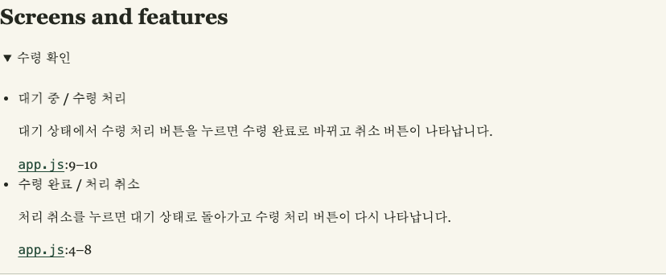
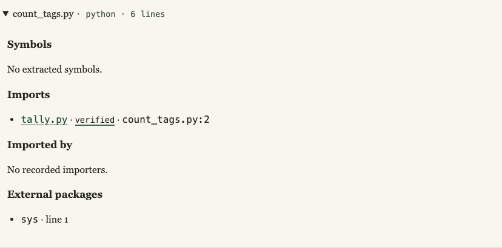

# Arche

Arche은 AI와 함께 변경한 코드베이스의 구조를 파악하고, 설명과 감사 결과를 소스 위치까지 거슬러 확인하는 [Agent Skill](https://agentskills.io/specification)입니다. 스킬 식별자는 **`arche`**입니다.

[공개 로드맵](docs/ROADMAP.md) · [에이전트 평가](docs/evaluation.md) · [릴리스](https://github.com/KooEric/arche/releases)

Arche helps developers understand codebases through source-backed walkthroughs, offline reports, change audits, and reproducible synthetic agent evaluations.

## 스킬 설치와 실행

1. Python 3.9 이상을 준비하고 [GitHub Releases](https://github.com/KooEric/arche/releases)에서 선택한 버전의 분석 스킬 ZIP을 내려받아 압축을 풉니다.
2. `skills/arche/SKILL.md`가 있는 폴더에서 사용하는 클라이언트에 맞게 설치합니다. 다음 명령은 Codex의 사용자 설치 예시입니다. 기존 설치가 있으면 위치를 출력합니다.

```sh
skill_home="$HOME/.agents/skills"
if [ -e "$skill_home/arche" ] || [ -L "$skill_home/arche" ]; then
  printf '기존 설치 경로: %s/arche\n' "$skill_home"
else
  mkdir -p "$skill_home" && cp -R skills/arche "$skill_home/arche"
fi
```

3. 분석할 레포에서 새 세션을 열고 아래처럼 호출합니다. 답변에 있는 로컬 HTML을 열면 대표 기능과 소스 근거를 볼 수 있습니다.

| 클라이언트 | 사용자 설치 위치 | 호출 예 |
|---|---|---|
| Codex | `~/.agents/skills/arche` | `$arche 레포 분석` |
| Claude Code | `~/.claude/skills/arche` | `/arche 레포 분석` |
| Cursor Agent | `~/.cursor/skills/arche` | `arche 스킬로 레포 분석해 줘` |

[프로젝트별 설치, 수동 실행 및 실제 검증 기록](docs/installation-and-reuse.md)

## 어떤 결과가 나오나요?

**화면에서 코드로.** 합성 수령 확인 앱에서 ‘수령 처리’를 누르면 상태가 ‘수령 완료’로 바뀌고 ‘처리 취소’가 나타납니다. 리포트의 **Screens and features**를 펼치면 이 전환을 설명하는 `app.js` 줄을 찾을 수 있습니다.



[UI 소스](evals/walkthrough-fixtures/ui) · [오프라인 UI 리포트](docs/examples/first-run/ui.html)

**명령에서 출력으로.** 합성 CLI에서 `python3 count_tags.py red red blue`의 예상 출력은 순서대로 `blue 1`, `red 2`입니다. **File dependencies**에서 `count_tags.py`를 펼치면 집계를 담당하는 `tally.py`로 이어지는 import를 확인할 수 있습니다.



[CLI 소스](evals/walkthrough-fixtures/cli) · [오프라인 CLI 리포트](docs/examples/first-run/cli.html)

GitHub에서 HTML 예제를 보려면 파일 페이지에서 **Download raw file**을 선택하고 내려받은 파일을 브라우저로 여세요. 직접 설치를 시험해 볼 수 있는 [첫 사용자 과제](docs/first-use.md)도 있습니다.

스킬은 결과를 레포 밖의 새 디렉터리에 씁니다. HTML은 브라우저에서 오프라인으로 열 수 있습니다. 파일명을 검색하고 파일을 펼쳐 심볼, 들어오고 나가는 의존성, 외부 패키지, 근거 위치를 볼 수 있습니다. 리포트에는 분석 제외 사유, 최근 Git 커밋, 검증된 정적 import의 대표 순환 참조가 포함됩니다. 파일의 역할과 배경은 에이전트가 소스 근거를 바탕으로 대화에서 설명합니다.

## 검증과 범위

정적 분석 어댑터는 Python·TypeScript·JavaScript·Dart·Go를 지원합니다. 합성 레포 7개의 정답과 import 관계를 대조합니다. Dart의 HTTP 요청과 Worker의 OpenAPI 라우트가 발견되면 HTML의 **HTTP connections**에서 메서드·경로와 양쪽 소스 위치를 볼 수 있습니다. 유일하게 매칭된 후보도 배포 호스트와 런타임 호출은 별도 확인이 필요합니다.

```sh
python3 evals/score.py
```

스킬을 설치한 Codex에서 `$arche 레포 분석`으로 시작하세요. 이어서 “번역기가 없을 때 흐름을 보여줘”, “이 두 커밋의 변경과 영향 후보를 설명해줘”, “이 투어를 Mermaid로 내보내줘”처럼 요청할 수 있습니다. Git 변경 목록에는 정적 의존성으로 찾은 영향 후보가 표시됩니다. 감사 규칙은 근거 줄과 함께 순환·반복 import를 표시합니다.

[클라이언트별 호출과 투어 재사용](docs/installation-and-reuse.md) · [Terra on/off 실험과 재채점](skills/arche-eval/scripts/studies/README.md)

[공개 후보 변경 사항](docs/release-notes.md) · [MIT 라이선스](LICENSE)

[공개 개발과 PR 절차](CONTRIBUTING.md)

## 평가 및 1.0 개발

`arche-eval`로 합성 레포의 코드 이해와 수정 행동을 평가하고, 저장된 실행을 모델 재호출 없이 채점할 수 있습니다.

[평가 사용법](docs/evaluation.md) · [정적 감사](docs/audit.md) · [RC 자료 호환성](docs/artifact-compatibility.md) · [릴리스 패키징](docs/releasing.md)
